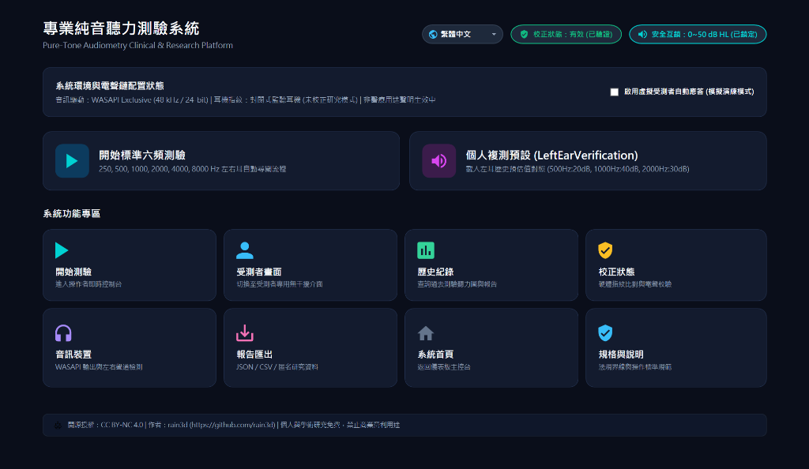
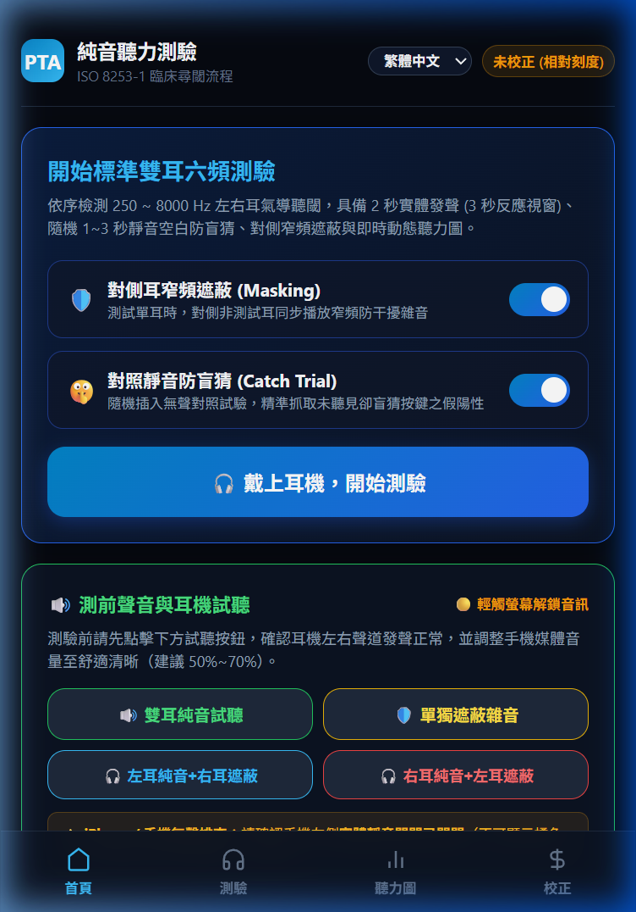

# 專業純音聽力測驗系統 (HearingTest) 使用說明手冊
# Professional Pure-Tone Audiometry System User Manual

[繁體中文版 (Traditional Chinese)](#繁體中文版-traditional-chinese) | [English Version](#english-version)

---

## 繁體中文版 (Traditional Chinese)

> **專案作者**：[rain3d](https://github.com/rain3d)  
> **版本**：v2.2.0 (全功能整合與多語系支援版)  
> **適用作業系統**：Windows 10 / Windows 11 (64-bit)  
> **架構形式**：Self-Contained 免安裝獨立可攜版（內建執行時期環境，無任何相依安裝需求）  
> **開源授權**：[CC BY-NC 4.0 (非商業用途／個人研究免費)](#5-開源授權與非商業用途聲明)  
> **法定類別聲明**：研究／個人聽力趨勢追蹤工具（非醫療器材／非正式臨床診斷）

---

### 軟體介面預覽 (UI Preview)

  

  <em>桌面端控制台介面（支援雙螢幕操作、繁中/簡中/英文即時熱切換、安全互鎖與電聲校正）</em>

  

  <em>手機端 Web PWA 介面（支援手機瀏覽器免安裝、對照靜音防盲猜、雷達脈衝與大按鍵反應）</em>

---

### 1. 快速開始 (Quick Start)

1. **直接啟動**：在資料夾內直接雙擊 `HearingTest.exe` 即可啟動（無黑色命令提示字元 Console 視窗，桌面與工作列顯示專用聽力波形圖示）。
2. **硬體準備**：將立體聲監聽耳機或聽力計專用耳機連接至 Windows 預設音訊端點。
3. **開始測驗**：
   - 在首頁點擊 **「開始標準六頻測驗」**，系統將依序測試左耳與右耳之標準頻率（1000、2000、4000、8000、1000 複驗、500、250 Hz）。
   - 或點擊 **「個人快速複測 (LeftEarVerification)」** 載入模擬聽閾進行端對端驗證。

---

### 2. 核心功能與操作指南

#### 2.1 雙畫面操作模式 (Dual-Screen Setup)
- **操作者控制台 (Operator Console)**：即時檢視純音聽力圖 (Live Audiogram)、測試進度、各頻率刺激序列、假陽性率評估與緊急停止。
- **多語系介面切換 (Multilingual UI Support)**：
  - 支援 **繁體中文 (Traditional Chinese)**、**簡體中文 (Simplified Chinese)**、**英文 (English - US)** 三種語系。
  - 於各畫面右上角點選地球圖示語言下拉選單，即可**即時無縫切換**，無需重新啟動程式。
  - 受測者視窗 (Patient Window) 亦會同步自動更新語系。
  - 使用者語言偏好設定將自動保存（儲存於本機偏好設定），下次開啟程式自動恢復。
- **受測者專用視窗 (Patient Window)**：
  - 點擊控制台頂部 **「開啟受測者獨立視窗 (副螢幕)」** 按鈕。
  - 將受測者視窗拖曳至副螢幕或受測者平板／觸控螢幕並最大化。
  - 受測者視窗僅顯示極簡的反應提示與超大綠色感應按鈕，遮蔽所有頻率與分貝等技術參數，符合聽力學盲測規範。

#### 2.2 操作快捷鍵 (Keyboard Shortcuts)
- **空白鍵 (Space)**：受測者反應（「我有聽到」）。
- **F5 鍵**：播放下一次刺激。
- **Esc 鍵**：**全域緊急停止 (Emergency Stop)**，瞬間強制中斷音訊端點並清空緩衝區 (< 5 ms)。

#### 2.3 對側窄頻遮蔽 (Contralateral Narrowband Masking)
- 符合 ISO 8253-1 規範，當測試耳純音強度與對側耳聽閾差異達 40 dB (跨耳衰減 IA) 時，系統自動跳出黃色警示提示啟用遮蔽。
- 支援手動啟用對側遮蔽，自動或手動調整 0 ~ 50 dB HL (5 dB 步階)。
- 測左耳時：左聲道輸出純音／脈衝音，右聲道輸出以測試頻率為中心之 1/3 倍頻程帶通窄頻噪音；測右耳時完全鏡像反向。
- 具備同側防呆互鎖，絕不允許同耳輸出遮蔽。

#### 2.4 校正檔與防竄改安全機制 (Calibration & Security)
- 進入「設備校正」分頁，可查閱本機硬體指紋 (Hardware Fingerprint) 與校正點。
- 支援匯入由合格校正實驗室簽發之 `.json` 校正檔，系統具備 **SHA-256 + HMAC-256 數位簽章** 與 **硬體指紋綁定驗證**。
- 若更換音訊裝置、端點或校正檔遭竄改／過期，系統將自動拒絕並強制鎖定為【未校正研究模式】，避免輸出不安全之錯誤音量。

#### 2.5 報告匯出與資料庫保存 (Reporting & Audit)
- 測驗完成後，所有歷程事件均自動安全寫入本機 SQLite 資料庫 (`hearing_test.db`)。
- 支援匯出 **JSON** 與 **CSV** 格式報告。
- 匯出時支援 **匿名去識別化 (PII Redacted)**，自動遮蔽受測者個人隱私個資，產出標準研究追蹤報告。

---

### 3. 安全規格與白名單限制

> ⚠️ **【重要聽力保護安全警語】**
> - **耳機音量務必先調低再行測試**：受測者於每次戴上耳機施測前，**請務必先將作業系統、耳機擴大器或播放設備之音量旋鈕調至「低音量」狀態**。切勿在系統處於高音量或未知音量下直接啟動測驗，以防突發大音量刺激造成急性聽力創傷 (Acoustic Trauma) 或聽力受損！
> - 測驗開始後，可透過「測前試聽」確認聲音清晰舒適（建議維持系統實體音量約 50%~70%），施測全程請勿再隨意更動音量旋鈕。

- **測試頻率白名單**：嚴格鎖定於 250, 500, 1000, 2000, 4000, 8000 Hz。
- **測試強度白名單**：硬限制於 **0 ~ 50 dB HL**，每階固定 **5 dB**；數位音訊層硬限制於 **-10.0 dBFS**。
- **開關瞬態保護**：全訊號（純音與遮蔽噪音）皆套用 25 ms Raised-Cosine（升降餘弦）平滑窗，消除高頻爆音 (Click/Thump)。
- **50 dB HL 無反應原則**：於 50 dB HL 上限連續兩次無反應時，自動標記為 `NR @ 50 dB HL` 並推進至下一頻率，防止音量過大損害聽力。

---

### 4. 法規聲明與免責條款 (Disclaimer & Intended Use)

> ⚖️ **【舊式工具免責權與非醫療器材聲明】**
> 本工具為依循 ISO 8253-1 臨床純音聽閾測試邏輯所研發之純音聽力研究與個人健康自我追蹤輔助軟體，**並非主管機關查驗核准之臨床醫療器材，亦不具備任何正式法律效力與醫療診斷處方權限**。
> 1. 本工具之量測數值受各廠牌耳機頻響曲線、系統音量增益與環境背景噪音影響，結果僅供個人聽力趨勢長期自我比對與學術交流參考。
> 2. 嚴禁用於正式醫療診斷、保險理賠、兵役體檢認定或職業勞保失能判定。
> 3. 若受測者自覺有急性單側聽力衰退、持續性高頻耳鳴、眩暈或耳朵疼痛等症狀，應立即前往醫院耳鼻喉科（ENT）專科門診尋求合格醫師與聽力師之正式診斷與治療。

---

### 5. 開源授權與非商業用途聲明

- **原作者**：[rain3d (GitHub)](https://github.com/rain3d)
- **授權條款**：[Creative Commons Attribution-NonCommercial 4.0 International (CC BY-NC 4.0)](https://creativecommons.org/licenses/by-nc/4.0/deed.zh-hant)
- **個人自由使用 (Free for Personal Use)**：
  - ✅ 個人日常聽力健康追蹤、家庭自主量測。
  - ✅ 學校教學、學術研究、非營利性展示。
  - ✅ 個人在非營利前提下自由閱讀、修改與調試原始碼。
- **嚴格禁止商業營利 (Commercial Use Strictly Prohibited)**：
  - ❌ **未經原作者 (rain3d) 事先書面正式授權，任何人、機構或法人團體皆不得將本軟體或其衍生代碼用於任何商業用途**。
  - ❌ 禁止用於收費之醫療機構、健檢中心、聽力所之營利性篩檢服務。
  - ❌ 禁止轉售、再授權、或作為付費軟硬體（耳機、平板、醫療箱等）之商業套裝捆綁販售。
  - 商業合作或授權洽詢請直接透過 GitHub 聯繫原作者：[https://github.com/rain3d](https://github.com/rain3d)。

---

## English Version

> **Author**: [rain3d](https://github.com/rain3d)  
> **Version**: v2.2.0 (Full Feature Integration & Multilingual Support)  
> **Supported OS**: Windows 10 / Windows 11 (64-bit)  
> **Distribution Type**: Self-Contained Standalone Portable Edition (Built-in runtime; zero external installation dependencies)  
> **License**: [CC BY-NC 4.0 (Non-Commercial / Free for Personal Use)](#5-open-source-license--non-commercial-notice)  
> **Regulatory Classification**: Research / Personal Hearing Trend Tracking Tool (Non-medical device / Not for formal clinical diagnosis)

---

### User Interface Preview

  

  <em>Desktop Operator Console (Supports dual-screen setup, real-time zh-TW/zh-CN/en-US switching, safety interlocks, and electroacoustic calibration)</em>

  

  <em>Mobile Web PWA Interface (Zero-install browser app, silent catch trial anti-guessing, radar pulse, and giant response button)</em>

---

### 1. Quick Start

1. **Launch Directly**: Double-click `HearingTest.exe` in the application folder to launch (no black command prompt console window; taskbar and desktop display dedicated audiogram waveform icon).
2. **Hardware Setup**: Connect stereo monitor headphones or audiometric earphones to the default Windows audio output endpoint.
3. **Begin Testing**:
   - On the Home page, click **"Start Standard 6-Frequency Test"**. The system will sequentially test standard frequencies for both ears (1000, 2000, 4000, 8000, 1000 retest, 500, and 250 Hz).
   - Or click **"Quick Verification (LeftEarVerification)"** to load simulated thresholds for end-to-end verification.

---

### 2. Core Features & User Guide

#### 2.1 Dual-Screen Operation Mode
- **Operator Console**: Real-time view of the Live Audiogram, testing progress, stimulus presentation sequences, false-positive rate assessment, and emergency stop.
- **Multilingual UI Support**:
  - Full support for **Traditional Chinese (繁體中文)**, **Simplified Chinese (简体中文)**, and **English (US)**.
  - Switch languages seamlessly on the fly by clicking the globe dropdown in the top-right corner of any screen—**no restart required**.
  - The secondary Patient Window synchronizes language updates in real time.
  - Language preference is automatically saved to local app data (`%LOCALAPPDATA%\HearingTest\preferences.json`) and restored on next startup.
- **Dedicated Patient Window**:
  - Click the **"Open Patient Window (Secondary Screen)"** button at the top of the Operator Console.
  - Drag the Patient Window to a secondary monitor, patient-facing tablet, or touchscreen, and maximize it.
  - The Patient Window displays only minimalist response instructions and an oversized response button while completely hiding technical parameters (frequencies, decibels), adhering strictly to audiometric single-blind protocols.

#### 2.2 Keyboard Shortcuts
- **Space Bar**: Patient response ("I hear the tone").
- **F5**: Present the next stimulus.
- **Esc**: **Global Emergency Stop**, immediately cutting off audio output and flushing audio buffers (< 5 ms latency).

#### 2.3 Contralateral Narrowband Masking
- In accordance with ISO 8253-1, when the pure-tone level in the test ear exceeds the threshold of the non-test ear by 40 dB (interaural attenuation IA), a yellow alert automatically prompts for masking.
- Supports manual masking activation with automatic or manual adjustment between 0 and 50 dB HL (5 dB step size).
- Left-ear testing outputs tone/pulsed tone on the left channel and 1/3-octave bandpass noise centered at the test frequency on the right channel; right-ear testing is mirrored.
- Features built-in hardware/software interlocks that strictly prevent ipsilateral (same-ear) masking.

#### 2.4 Calibration Profiles & Anti-Tamper Security
- Navigate to the **"Calibration"** tab to view the local hardware fingerprint and calibration points.
- Import `.json` calibration certificates issued by accredited laboratories, secured with **SHA-256 + HMAC-256 digital signatures** and hardware fingerprint binding.
- If audio hardware/endpoints change or calibration certificates are altered or expired, the system automatically rejects the profile and locks into "Uncalibrated Research Mode" to prevent unsafe sound exposure.

#### 2.5 Report Export & Audit Trail
- Upon test completion, all session events and responses are securely logged to a local SQLite database (`hearing_test.db`).
- Supports exporting clinical reports in both **JSON** and **CSV** formats.
- Supports **De-identification (PII Redacted)**, automatically scrubbing patient personally identifiable information to produce standard research tracking reports.

---

### 3. Safety Specifications & Whitelist Safeguards

> ⚠️ **[Important Hearing Protection & Safety Notice]**
> - **Always Lower Headphone Volume Prior to Testing**: Before putting on headphones and initiating any testing procedure, **always make sure your OS, headphone amplifier, or sound device master volume is set to a LOW level first**. Never initiate testing at high or unverified volume levels to prevent accidental loud stimulus causing acute acoustic trauma or hearing damage!
> - Use the "Pre-test Sound Check" to confirm tones are comfortable and audible (keeping master physical volume around 50%~70%), and do not alter physical volume knobs during testing.

- **Frequency Whitelist**: Strictly locked to 250, 500, 1000, 2000, 4000, and 8000 Hz.
- **Intensity Whitelist**: Hard-capped between **0 and 50 dB HL** in **5 dB** fixed steps; digital audio layer hard-clamped at **-10.0 dBFS**.
- **Transient Switching Protection**: All audio signals (pure tones and masking noise) apply a 25 ms Raised-Cosine smoothing window to eliminate high-frequency clicks and thumps.
- **50 dB HL No-Response Rule**: If no response is detected twice consecutively at the 50 dB HL ceiling, the system automatically records `NR @ 50 dB HL` and advances to the next frequency to prevent acoustic overexposure.

---

### 4. Regulatory Notice & Disclaimer (Intended Use)

> ⚖️ **[Tool Disclaimer & Non-Medical Device Notice]**
> This utility is an open-source assistive application implementing ISO 8253-1 clinical pure-tone audiometry protocols designed solely for hearing research and personal wellness tracking. **It is NOT a certified clinical medical device, holds no regulatory medical approval, and carries no legal or diagnostic validity.**
> 1. Results depend on consumer headphone frequency responses, sound card DAC linearity, and ambient noise levels. They are intended strictly for personal long-term trend comparisons.
> 2. Strictly prohibited for formal medical diagnoses, disability certification, military evaluations, or insurance compensation claims.
> 3. If you experience sudden hearing deterioration, continuous tinnitus, dizziness, or ear discomfort, consult a qualified ENT physician and certified audiologist immediately for standard clinical evaluation.

---

### 5. Open Source License & Non-Commercial Notice

- **Author**: [rain3d (GitHub)](https://github.com/rain3d)
- **License**: [Creative Commons Attribution-NonCommercial 4.0 International (CC BY-NC 4.0)](https://creativecommons.org/licenses/by-nc/4.0/)
- **Permitted Free Use**:
  - ✅ Personal hearing trend tracking and self-health management.
  - ✅ Classroom education, academic research, and non-profit demonstrations.
  - ✅ Personal modification, inspection, and development for non-commercial purposes.
- **Strictly Prohibited Commercial Activities**:
  - ❌ **Any commercial exploitation without prior written consent from the author (rain3d) is strictly forbidden**.
  - ❌ Charging fees for testing, audiometric screening services, or clinical health checks using this software.
  - ❌ Selling, reselling, sublicensing, or bundling this software as paid value-added tools with commercial hardware products.
  - For commercial licensing inquiries or partnership proposals, please contact the author via GitHub: [https://github.com/rain3d](https://github.com/rain3d).
